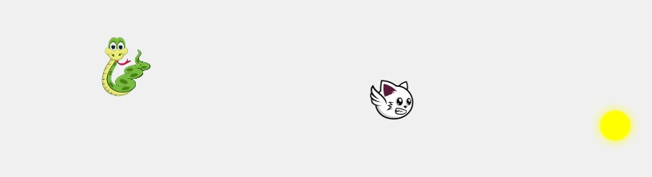

# Catnip

Catnip is a small browser game built with vanilla JavaScript. Guide the cat to collect coins while a snake chases it. Each coin adds a point; touching the snake ends the game.

I built it in April 2024 as practice for the **LKS (Lomba Kompetensi Siswa) Web Technology** competition, which includes a module on building a game with vanilla JavaScript.

> This is a practice project. It is not maintained.

## How to play

1. Open `index.html` in a browser.
2. Press **Start**.
3. Move the cat with the arrow keys or **W A S D**.
4. Collect coins and stay away from the snake.

The cat wraps around the screen edges, so you can escape through one side and come back from the other.

## Stack

- HTML5
- CSS3
- Vanilla JavaScript (no libraries, no build step)

## License

[MIT](LICENSE) © 2024 Andika Dwi Saputra
